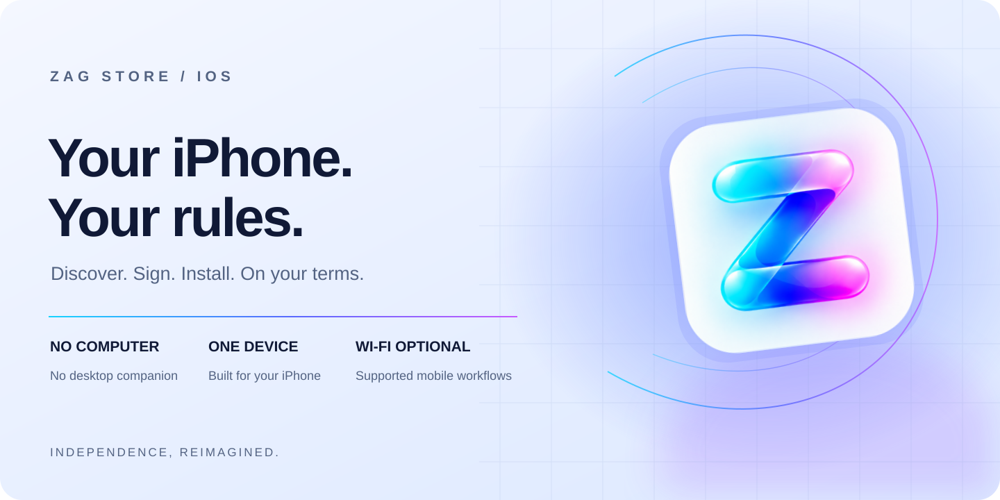
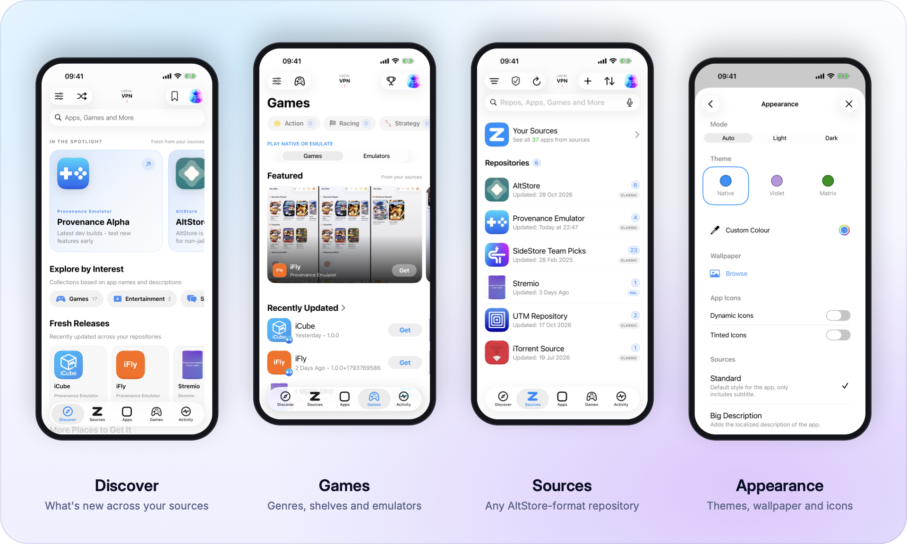
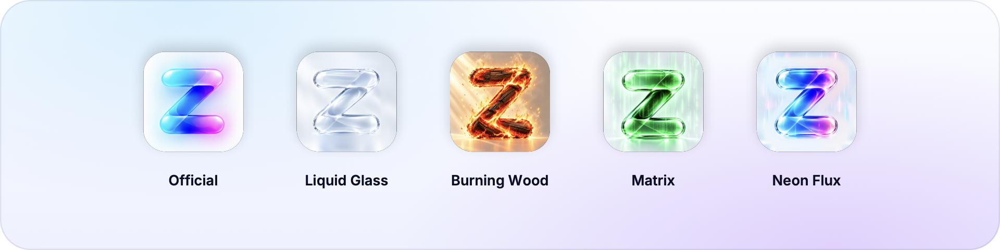

<div align="center">

<a href="https://zagstore.app">
  <picture>
    <source media="(prefers-color-scheme: dark)" srcset="docs/assets/readme/hero-dark.svg">
    
  </picture>
</a>

<br>

[](https://zagstore.app/how-it-works/)
[](https://github.com/zagorskey/zag-store/releases/tag/v1.0.0-beta.2)
[](docs/INSTALL.md#requirements)
[](docs/FEATURES.md)
[](RPPairingCore)
[](LICENSE)

[**zagstore.app**](https://zagstore.app) &nbsp;·&nbsp; [Install](docs/INSTALL.md) &nbsp;·&nbsp; [Beta 2 release](https://github.com/zagorskey/zag-store/releases/tag/v1.0.0-beta.2) &nbsp;·&nbsp; [Features](docs/FEATURES.md) &nbsp;·&nbsp; [From Feather](docs/FROM-FEATHER.md) &nbsp;·&nbsp; [Build](docs/BUILDING.md) &nbsp;·&nbsp; [Security](SECURITY.md)

</div>

<br>

**Zag Store is an app store for iPhone and iPad that you install from Safari, sign with your own certificate and run on a single device.** It brings apps from many repositories into one native, searchable home, then signs and installs them on the device itself, over Wi-Fi or mobile data.

It began as a fork of [Feather](https://github.com/claration/Feather). Since then it has been rebuilt into its own product: a redesigned SwiftUI app, an on-device pairing core written in Rust, a website that can sign and deliver the app straight to Safari, and a release system with cryptographically signed update metadata.

<table>
<tr>
<td width="33%" valign="top">

**🧭 Install from Safari** <sub>in testing</sub><br>
<sub>Open <a href="https://zagstore.app/install/">zagstore.app</a> on the iPhone itself, add your certificate, and install. No computer, cable or companion app.</sub>

</td>
<td width="33%" valign="top">

**📱 One device**<br>
<sub>Zag Store pairs with the device it runs on. No second phone, no desktop utility and, on iOS 17 or later, no pairing file.</sub>

</td>
<td width="33%" valign="top">

**📶 Wi-Fi optional**<br>
<sub>Install apps on Wi-Fi or mobile data. On mobile data, an Apple Shortcut switches Mobile Data off for the install, with your approval.</sub>

</td>
</tr>
</table>

> [!IMPORTANT]
> **What Zag Store doesn't change.** You still need your own Apple signing certificate and a provisioning profile that includes your device. iOS still verifies every signature and profile. Direct installation from the app still needs [LocalDevVPN](https://apps.apple.com/app/localdevvpn/id6755608044) and Developer Mode. [What's needed, step by step →](docs/INSTALL.md#what-each-step-needs)

<br>

<picture>
  <source media="(prefers-color-scheme: dark)" srcset="docs/assets/readme/showcase-dark.png">
  
</picture>

<p align="center"><sub>Unedited screenshots of the current beta, captured in the iOS Simulator with open-source repositories. Shown side by side for comparison; one iPhone is all you need.</sub></p>

<br>

<picture>
  <source media="(prefers-color-scheme: dark)" srcset="docs/assets/readme/chapter-01-dark.svg">
  
</picture>

Zag Store doesn't just rename Feather. It has its own name, its own iconography and its own visual language, shared with [zagstore.app](https://zagstore.app): a refracted cyan-to-magenta spectrum on deep midnight and pearl surfaces.

<picture>
  <source media="(prefers-color-scheme: dark)" srcset="docs/assets/readme/app-icons-dark.png">
  
</picture>

- **Seven original app icons.** Official, Liquid Glass, Burning Wood, Matrix, Golden Reserve, Sterling and Neon Flux, each with light and dark variants.
- **A cinematic launch.** A branded splash plays on cold launch. Tap to skip it. Its sound can be turned off and respects the silent switch.
- **Your colours, in Display P3.** Feather's accent presets, retuned with Native, Violet and Matrix, plus a custom colour. Every theme is rendered as wide-gamut Display P3 colour. Wallpapers, and Light, Dark or Automatic mode.
- **Zag Store Designer.** Live-preview controls for headers, row styles, separators, and standard and update badges.

<br>

<picture>
  <source media="(prefers-color-scheme: dark)" srcset="docs/assets/readme/chapter-02-dark.svg">
  
</picture>

Feather's four tabs (Sources, Library, Settings and Certificates) became a **customisable five-slot dock**. Choose any five of seven destinations, in any order:

<table>
<tr>
<td width="50%" valign="top">

### ✦ Discover
Spotlights, interest collections and fresh releases from all your repositories, with promotional artwork and screenshot galleries.

</td>
<td width="50%" valign="top">

### ◎ Sources
Every AltStore-format repository you follow, with app counts, last-refresh times and background refresh, and each installed app traced back to the repository it came from.

</td>
</tr>
<tr>
<td width="50%" valign="top">

### ▣ Apps
Your signed and installed apps, with update badges and the installed versions read from the device.

</td>
<td width="50%" valign="top">

### ◆ Games
Genre shelves and a separate Emulators collection, with native scope controls.

</td>
</tr>
<tr>
<td width="50%" valign="top">

### ◷ Activity
Every download, signing step and installation as it happens, with history.

</td>
<td width="50%" valign="top">

### ⌁ Devices and Settings
Optional dock tabs: this device's system and storage status, or Settings, one tap away.

</td>
</tr>
</table>

- **Liquid Glass, done natively.** On iOS 26, Zag Store uses SwiftUI's own glass effects and system controls. The dock can also shrink as you scroll.
- **One search experience.** The same native search field everywhere, with **voice search** where iOS offers dictation.
- **Redesigned management.** Certificate management shows status at a glance, and signing options and every Settings screen have been rebuilt.
- **Consistent details.** Layout, spacing, animation and refresh behaviour are aligned across every screen.

<br>

<picture>
  <source media="(prefers-color-scheme: dark)" srcset="docs/assets/readme/chapter-03-dark.svg">
  
</picture>

Getting sideloaded apps onto an iPhone has usually meant a computer, a cable and a companion app. Zag Store removes those from both steps. **Step one** gets Zag Store onto your device.

<picture>
  <source media="(prefers-color-scheme: dark)" srcset="docs/assets/readme/journey-dark.svg">
  
</picture>

**Step two** installs apps from inside Zag Store, with no other device involved.

<picture>
  <source media="(prefers-color-scheme: dark)" srcset="docs/assets/readme/pairing-dark.svg">
  
</picture>

<details>
<summary><b>Exactly what "Wi-Fi optional" means</b></summary>

<br>

- **On Wi-Fi**, Zag Store installs directly through LocalDevVPN's on-device connection.
- **On mobile data**, iOS refuses that local connection while Mobile Data is switched on. Zag Store detects this from the installer's own response. With your approval, it then runs the official *Zag Mobile Data Toggle* Shortcut to turn Mobile Data off for the install and back on afterwards. Zag Store never asks for anything else.
- **Downloading** an app still needs an internet connection. Automatic downloads of Zag Store's own updates wait for Wi-Fi by design.
- **iOS 16.4 to 16.7** use the older installation method, which needs a pairing file created on a computer.

</details>

<br>

<picture>
  <source media="(prefers-color-scheme: dark)" srcset="docs/assets/readme/chapter-04-dark.svg">
  
</picture>

### The Safari signing service

The website installer is backed by a dedicated signing service that is part of the Zag Store ecosystem. Its source is not part of this repository.

- **Bring your own certificate.** Zag Store never provides, shares or rents certificates. Your `.p12`, password and profile travel over an encrypted connection to sign one copy of the app. The installer page doesn't save them.
- **Isolated work.** A gateway accepts requests. Signing runs in separate, sandboxed worker services, and preview and production run as separate environments.
- **Strict validation.** Credential frames are validated strictly. Every result is bound to its signing job, its bundle identifier and the SHA-256 of the signed artifact, and anything malformed, tampered with or mismatched is rejected.
- **Scoped delivery.** Every install link is private, scoped to its signing job, and expires.
- **Fail closed.** When a check can't be completed, the job stops; it doesn't fall back to a weaker path.
- **Regression-tested.** The service is tested against malformed input, wrong identities, tampered artifacts, expired credentials and incompatible protocol versions.

### Signing and installing on the device

- **[Zsign](https://github.com/zhlynn/zsign) on the device.** Signing inside the app happens on your iPhone. Your certificates stay in the app.
- **A Rust pairing core.** [`RPPairingCore`](RPPairingCore) (2,273 lines of Rust on [idevice](https://github.com/jkcoxson/idevice)) handles remote pairing, Pair-Verify, the TLS-PSK tunnel, RSD, the installation proxy and AFC.
- **Built-in health checks.** A diagnostic tests every stage of that chain, and a connection trace explains failures. Copied reports include the network type, timings and the first failing step, but never device names, pairing records, certificate material or keys.

### Self-updating, with integrity

| | Status |
| --- | --- |
| In-app update detection, release notes and update indicators | ✅ Available |
| Channels: **Stable** (default), **Beta** and **Nightly** | ✅ Available |
| Automatic checks on launch and on return, with Wi-Fi-only automatic downloads | ✅ Available |
| SHA-256 verification of every downloaded update | ✅ Available |
| **Ed25519-signed update metadata**, with sequence numbers, expiry, rollback protection and strict schema checks | ✅ Active on the **Beta** channel · Stable and Nightly planned |

Signing and installing an update always waits for your approval.

### Performance and size

- **Opt-in, on-device instrumentation.** Records launch milestones and per-phase repository refresh timings, with median and p95 reports. It's [off by default and sends nothing](docs/PERFORMANCE-DIAGNOSTICS.md).
- **Less unnecessary work.** Repository refreshes no longer re-render views that don't read them. Startup reconciliation runs independently of navigation, and screenshot galleries decode thumbnails instead of full-size images.
- **A smaller package.** Release asset storage and Swift code size were optimised. The [measured comparison](docs/IPA-SIZE-INVESTIGATION-2026-11-03.md) saved 1.14 MiB. The current unsigned release IPA is about **58 MiB**.

<br>

<picture>
  <source media="(prefers-color-scheme: dark)" srcset="docs/assets/readme/chapter-05-dark.svg">
  
</picture>

<picture>
  <source media="(prefers-color-scheme: dark)" srcset="docs/assets/readme/ecosystem-dark.svg">
  
</picture>

Zag Store is one product in two halves. The app is open source here. [zagstore.app](https://zagstore.app) provides:

- a searchable catalogue that recognises the same app across repositories and lists it once;
- a repository directory;
- the Safari installer.

Behind the website are the signing service and installation insights that help the project understand how website installations perform.

### Privacy and your control

The privacy features run in two places. This section says which is which.

| | Where it runs | Your control |
| --- | --- | --- |
| Certificates, profiles and pairing credentials used by the app | On your device | Import, choose per app, remove. Unpair at any time |
| Performance diagnostics | On your device | Off by default. Nothing is sent |
| Signing from Safari | Zag Store's signing service | You upload your certificate for that one signing. The page doesn't save it |
| Signing and download events, with installation attribution | Server-side | Recorded for website installs |
| Network classification of signing requests (for example, recognising VPN providers) | Server-side, using a third-party IP-reputation service | Applies to website signings |
| First-launch report | Sent once by copies installed from the website | **On by default; turn it off in Settings and nothing is sent.** It contains the website download's installation code, the app version and build, iOS version and build, and device model. The server stores it without your IP address |
| Jailbreak status (yes, no or unknown, rootless or rootful) | Sent once, only if you turn it on | **Off by default.** Never which files, tweaks or apps were found |

Jailbreak statistics are published only as weekly totals of at least 10 devices, and individual results are deleted within 30 days. Reports never include installed-app lists or hardware identifiers.

> [!NOTE]
> Feather describes itself as having no tracking or analytics. Zag Store differs: it reports website installations as described above. You can turn off the first-launch report, and jailbreak status is opt-in.

<br>

<picture>
  <source media="(prefers-color-scheme: dark)" srcset="docs/assets/readme/chapter-06-dark.svg">
  
</picture>

| | Status |
| --- | --- |
| The iOS app: discovery, sources, signing, installation, self-update | 🟣 Public beta |
| Installing Zag Store from Safari with your own certificate | 🟠 In testing, as shown on [zagstore.app](https://zagstore.app/how-it-works/) |
| Developer diagnostics: controlled test install, House Arrest browser, update-signature diagnostics | 🟡 Experimental |
| Ed25519-signed metadata for the Stable and Nightly channels | 🔵 Planned |
| A downloadable unsigned IPA, with its SHA-256 checksum | 🟣 Public beta: [1.0.0 Beta 2](https://github.com/zagorskey/zag-store/releases/tag/v1.0.0-beta.2) |
| Installing catalogue apps directly from zagstore.app | 🔵 Planned |
| Pages for every repository app on the website | 🔵 Planned |
| Optional accounts and settings sync | 🔵 Planned |

🟣 **Public beta**: in the current beta app, still being refined. 🟠 **In testing**: live, being verified end to end. 🟡 **Experimental**: tools for diagnosing problems, which may change or be removed. 🔵 **Planned**: not available yet. Planned items aren't promises. They ship when they're ready and verified.

<br>

## From Feather to Zag Store

<picture>
  <source media="(prefers-color-scheme: dark)" srcset="docs/assets/readme/evolution-dark.svg">
  
</picture>

Zag Store stands on the work of [Feather](https://github.com/claration/Feather), created by [Samara (claration)](https://github.com/claration) and its contributors. Feather's signing engine, repository support, tweak injection and much of its foundation remain at Zag Store's core, and we're grateful for them.

The comparison below was checked against Feather's source at **v2.9.0**, the fork point, and at Feather's `main` branch as of 1 November 2026 (`31ab6de`). Feather is actively developed, so this may change.

| | Feather | Zag Store |
| --- | --- | --- |
| **Getting the app** | Download the `.ipa` or add its AltSource, then sideload it your own way | The same, **plus** signing and installing straight from Safari at zagstore.app |
| **On-device installation** | *Server* (local HTTPS with `itms-services`) or *IDevice* (pairing file from a computer + LocalDevVPN) | **On-device pairing with a code** on iOS 17 and later; pairing file on iOS 16.4–16.7. Feather's Server mode is not included |
| **Installing on mobile data** | No mobile-data handling for pairing-based installs in the source | **Mobile Data Fix:** a verified Shortcut turns Mobile Data off for the install, with approval |
| **Navigation** | Four tabs | **Customisable five-slot dock** from seven destinations |
| **Discovery** | Sources and Library | **Discover, Games, Activity**, interest collections, promotional artwork, screenshot galleries |
| **Search** | Search fields | Unified native search with **voice input** |
| **Updating the store itself** | Not built in | **Stable / Beta / Nightly channels**, SHA-256 checks, Ed25519-signed metadata on Beta |
| **App updates from sources** | ✅ Built in | ✅ Inherited, with startup reconciliation and update badges |
| **Signing, tweaks, AltStore repositories** | ✅ Built in | ✅ Inherited |
| **Appearance** | Accent presets, alternate Feather icons | Seven original icons, retuned presets, custom colour, wallpapers, Designer, cinematic splash |
| **Analytics** | None | Website-install reporting ([details](#privacy-and-your-control)) |

Read the full, evidence-based account in **[From Feather to Zag Store](docs/FROM-FEATHER.md)**.

<br>

## Get started

1. **On your iPhone or iPad, open [zagstore.app/install](https://zagstore.app/install/) in Safari.** Add your signing certificate (`.p12`), its password and a provisioning profile that includes the device, then tap *Sign Zag Store*.
2. **Install** when iOS asks, and open Zag Store.
3. **For direct installs**, turn on Developer Mode, install [LocalDevVPN](https://apps.apple.com/app/localdevvpn/id6755608044), and pair in **Settings → Installation**.

The [installation guide](docs/INSTALL.md) covers requirements, mobile data, older iOS versions and troubleshooting.

**Prefer to sign it yourself?** Download the unsigned IPA from the **[1.0.0 Beta 2 release](https://github.com/zagorskey/zag-store/releases/tag/v1.0.0-beta.2)**, check its SHA-256 checksum, and sign and install it with any tool you trust. The [installation guide](docs/INSTALL.md#alternative-sign-the-unsigned-ipa-yourself) explains how.

## Build from source

```bash
git clone --recurse-submodules https://github.com/zagorskey/zag-store.git
cd zag-store
bash RPPairingCore/build-rust.sh   # the Rust pairing core, once
make iphoneos                       # → packages/ZagStore.ipa (unsigned)
```

You need macOS with Xcode 26 and [Rust](https://rustup.rs). See **[Building Zag Store](docs/BUILDING.md)** for details, tests and the repository layout.

## Documentation

| | |
| --- | --- |
| [Installation guide](docs/INSTALL.md) | Requirements, Safari install, pairing, mobile data, troubleshooting |
| [Feature guide](docs/FEATURES.md) | Every feature, and whether it came from Feather, was redesigned or is new |
| [From Feather to Zag Store](docs/FROM-FEATHER.md) | The evolution, with methodology and sources |
| [How it works](HOW_IT_WORKS.md) | Signing, pairing and installation internals |
| [Ecosystem and privacy](docs/ECOSYSTEM.md) | Website, signing service, release channels and data handling |
| [Building](docs/BUILDING.md) | Build, test and repository layout |
| [Release channels](releases/README.md) | How self-update channels and manifests work |
| [Source provenance](docs/SOURCE-PROVENANCE.md) | The exact source each published build was made from |

## Acknowledgements and licence

Zag Store is a fork of **[Feather](https://github.com/claration/Feather)** and keeps Feather's GPL-3.0 licence and copyright notices. It is independent, and isn't affiliated with Apple or the Feather project. The main open-source components:

| Project | Used for | Licence |
| --- | --- | --- |
| [Feather](https://github.com/claration/Feather) | The original app, signing and repository experience | GPL-3.0 |
| [AltSourceKit](AltSourceKit), [NimbleKit](NimbleKit) | Repository models and SwiftUI helpers, from Feather | MIT |
| [idevice](https://github.com/jkcoxson/idevice) | Device communication, via the [IDeviceKit-Zag](https://github.com/zagorskey/IDeviceKit-Zag) fork | MIT |
| [Zsign](https://github.com/zhlynn/zsign) | IPA signing, via the [Zsign-Zag](https://github.com/zagorskey/Zsign-Zag) fork | MIT, with LiveContainer code under Apache-2.0 |
| [ElleKit](https://github.com/evelyneee/ellekit) | Tweak injection support | [BSD-style](LICENSE_ELLEKIT) |
| [Nuke](https://github.com/kean/Nuke) | Image loading and caching | MIT |
| [OpenSSL](https://github.com/krzyzanowskim/OpenSSL) | Cryptography | Apache-2.0 |
| [Zip](https://github.com/marmelroy/Zip), [SWCompression](https://github.com/tsolomko/SWCompression) | Archives | MIT |

The complete list, including the Rust crates and Feather's own acknowledgements, is in **[ACKNOWLEDGEMENTS.md](ACKNOWLEDGEMENTS.md)**. Each component's own licence applies to that component.

Zag Store is licensed under the [GNU General Public License v3.0](LICENSE). The complete source of every published build, including all submodules, is public; [Source provenance](docs/SOURCE-PROVENANCE.md) maps each release to its exact commits.

## Contributing

Bug reports, design feedback and pull requests are welcome. Read [CONTRIBUTING.md](CONTRIBUTING.md) and the [Code of Conduct](CODE_OF_CONDUCT.md) first. Report security problems privately, as described in [SECURITY.md](SECURITY.md), never in a public issue.

<br>

<div align="center">
<sub><b>Zag Store</b> · Discover more. Make it yours. · <a href="https://zagstore.app">zagstore.app</a></sub>
</div>
