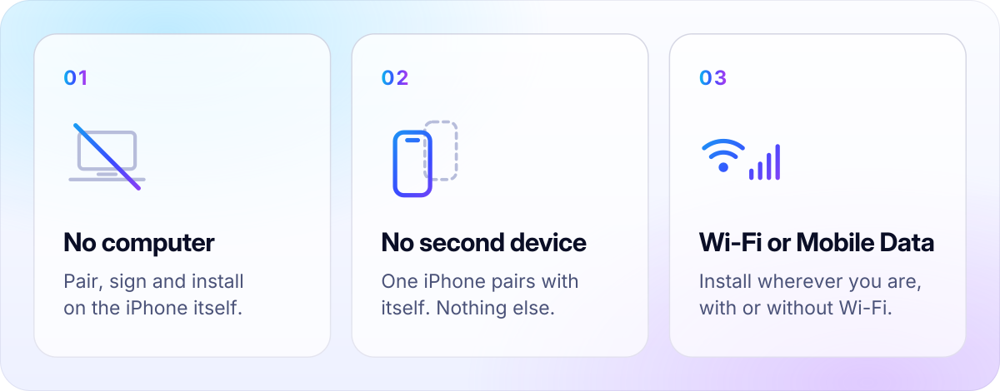

<div align="center">

<a href="https://zagstore.app">
  <picture>
    <source media="(prefers-color-scheme: dark)" srcset="docs/assets/readme/hero-dark.svg">
    
  </picture>
</a>

<br>

[**zagstore.app**](https://zagstore.app) &nbsp;·&nbsp; [Releases](https://github.com/zagorskey/zag-store/releases) &nbsp;·&nbsp; [Install](#install) &nbsp;·&nbsp; [Build](#build-from-source) &nbsp;·&nbsp; [Security](SECURITY.md)

</div>


## Built for independence

**No desktop companion. No second phone. No Wi-Fi-only installation requirement for supported workflows.** The experience stays centered on your iPhone; pairing, LocalDevVPN and initial signing prerequisites are explained below.

<picture>
  <source media="(prefers-color-scheme: dark)" srcset="docs/assets/readme/promises-dark.svg">
  
</picture>

**Zag Store runs on your iPhone, and only your iPhone.** It browses repositories, signs apps with your own certificate, and installs, updates and removes them, all on the device. There's no desktop companion, no AltServer, and no second phone.

<details open>
<summary><b>What you need, and what happens once</b></summary>

<br>

| | Once | Every day |
| :-- | :-- | :-- |
| **Zag Store itself** | Sign the IPA with your certificate and install it, using a signing method you trust | Updates come from inside the app |
| **Your certificate** | Get a certificate and provisioning profile from your Apple developer account, then import them | Every app is signed on the iPhone |
| **Pairing** | Pair the iPhone with itself in Zag Store, with Developer Mode on and [LocalDevVPN](https://apps.apple.com/app/localdevvpn/id6755608044) installed (iOS 17 or later) | The pairing is reused for every install |
| **Network** | — | Install on Wi-Fi or Mobile Data |

- **LocalDevVPN is required.** It's a free App Store app that creates the local connection Zag Store uses to talk to the iPhone.
- **On Mobile Data**, iOS refuses that local connection while Mobile Data is on. With your approval, Zag Store uses the free *Zag Mobile Data Toggle* Shortcut to switch Mobile Data off for the moment of installation and back on straight afterwards. On Wi-Fi, nothing extra happens.
- **Automatic self-update downloads wait for Wi-Fi**, to save your data allowance.
- **iOS 16.4 to 16.7** use the older installation method, which needs a pairing file created on a computer.

</details>

<br>

<picture>
  <source media="(prefers-color-scheme: dark)" srcset="docs/assets/readme/showcase-dark.png">
  
</picture>

<p align="center"><sub>Unedited screenshots of the current beta, captured in the iOS Simulator with open-source repositories. Shown side by side for comparison; one iPhone is all you need.</sub></p>

## Discover a different kind of app store

Discover beautifully. Sign independently. Make it yours.

<table>
<tr>
<td width="50%" valign="top">

### Discover
Spotlights, collections and fresh releases from all your repositories, one tap away from installing.

</td>
<td width="50%" valign="top">

### Games and emulators
A dedicated Games tab with genre shelves, and a separate Emulators collection, classified automatically from Apple's public catalogue.

</td>
</tr>
<tr>
<td width="50%" valign="top">

### Sources
Add any AltStore-format repository, see what each one offers, and keep them all refreshed in the background.

</td>
<td width="50%" valign="top">

### Activity
Follow every download, signing step and installation as it happens. Pause and resume downloads from one place.

</td>
</tr>
</table>

## Your identity. Your signature.

Zag Store doesn't provide, share or rent certificates. You import your own `.p12` certificate and matching provisioning profile, and every app is signed on your iPhone with them.

- Your certificate, private key and profile stay on the device. They're never uploaded.
- You choose which certificate signs each app, and you can see when each one expires.
- Zag Store never asks for your Apple Account password.

> [!IMPORTANT]
> Never upload your private key, `.p12` file or certificate password to a service you don't trust. Zag Store's maintainers will never ask for them.

## Designed around you

<picture>
  <source media="(prefers-color-scheme: dark)" srcset="docs/assets/readme/app-icons-dark.png">
  
</picture>

Choose your app icon, your accent colour and your wallpaper, and arrange the dock with the tabs you use most. On iOS 26, Zag Store uses the system's own Liquid Glass controls, so it looks and behaves like the rest of your iPhone.

---

## Get started


> [!NOTE]
> **Zag Store is in public beta.** No release on this page is recommended for installation yet. The first public build will be published here, with its SHA-256 checksum, once it has been verified.

**Requirements**

- iPhone or iPad with **iOS 17 or later** for on-device pairing (iOS 16.4 or later is supported with a pairing file from a computer).
- **Developer Mode** turned on.
- Your own **certificate (`.p12`)** and matching **provisioning profile (`.mobileprovision`)**.
- **[LocalDevVPN](https://apps.apple.com/app/localdevvpn/id6755608044)** from the App Store.

**Steps**

1. Download `ZagStore.ipa` from [Releases](https://github.com/zagorskey/zag-store/releases) and compare its checksum with the one in the release notes:
   ```bash
   shasum -a 256 ZagStore.ipa
   ```
2. Sign it with your own certificate and profile, and install it.
3. Open Zag Store, import your certificate in **Settings → Certificates**, and pair the iPhone in **Settings → Installation**.

The release IPA is ad-hoc signed only. It carries no developer identity, so a stock iPhone won't install it until you sign it.

## For developers · Build from source

You need macOS with **Xcode 26** and [Rust](https://rustup.rs).

```bash
git clone --recurse-submodules https://github.com/zagorskey/zag-store.git
cd zag-store

bash RPPairingCore/build-rust.sh   # device-communication core, once
make iphoneos                       # → packages/ZagStore.ipa
```

> [!WARNING]
> The Zsign submodule needs an access change before an anonymous public clone can fetch every dependency. Until then, these steps work only for maintainers.

<details>
<summary><b>Repository layout</b></summary>

<br>

| Path | Contents |
| --- | --- |
| `Feather/` | The SwiftUI app. The folder keeps its upstream name. |
| `RPPairingCore/` | Rust core for pairing and installing on the device, built on `idevice` |
| `Zsign/` | IPA signing (submodule) |
| `IDeviceKitten/` | Device communication (submodule) |
| `AltSourceKit/`, `NimbleKit/` | Repository models and shared SwiftUI components from Feather |
| `scripts/` | Tests and release tooling |
| `docs/` | Design notes and README artwork |

</details>

## The open-source foundation

Zag Store is a fork of **[Feather](https://github.com/claration/Feather)** by [claration](https://github.com/claration) and its contributors. It keeps Feather's GPL-3.0 licence and copyright notices. Thank you to everyone who built it.

| Project | Used for | Licence |
| --- | --- | --- |
| [Feather](https://github.com/claration/Feather) | The original app, signing and repository experience | GPL-3.0 |
| [AltSourceKit](AltSourceKit) and [NimbleKit](NimbleKit) | Repository models and SwiftUI helpers, from Feather | MIT |
| [idevice](https://github.com/jkcoxson/idevice) | Device communication | MIT |
| [Zsign](https://github.com/zhlynn/zsign) | IPA signing | MIT |
| [ElleKit](https://github.com/evelyneee/ellekit) | Tweak injection support | [BSD-style](LICENSE_ELLEKIT) |
| [Nuke](https://github.com/kean/Nuke) | Image loading and caching | MIT |
| [OpenSSL](https://github.com/krzyzanowskim/OpenSSL) | Cryptography | Apache-2.0 |
| [Zip](https://github.com/marmelroy/Zip), [SWCompression](https://github.com/tsolomko/SWCompression) | Archives | MIT |

Each component's own licence applies to that component. The README artwork uses the [Inter](https://github.com/rsms/inter) typeface (SIL Open Font License 1.1). Zag Store is independent, and isn't affiliated with Apple or the Feather project.

Zag Store is licensed under the [GNU General Public License v3.0](LICENSE).

## Build the future with us

Bug reports, design feedback and pull requests are welcome. Read [CONTRIBUTING.md](CONTRIBUTING.md) and the [Code of Conduct](CODE_OF_CONDUCT.md) first, and see the [Changelog](CHANGELOG.md) for what's new.

Report security problems privately, as described in [SECURITY.md](SECURITY.md), never in a public issue.

<br>

<div align="center">
<sub><b>Zag Store</b> · Your iPhone. Your apps. Your rules. · <a href="https://zagstore.app">zagstore.app</a></sub>
</div>
