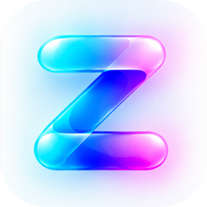

<div align="center">

<picture>
  <source media="(prefers-color-scheme: dark)" srcset="docs/assets/zag-store-icon-dark.png">
  
</picture>

# Zag Store

**Your apps. Your certificate. Your way.**

Discover, sign, install and manage apps on iPhone and iPad, all in one app.

[Website](https://zagstore.app) · [Releases](https://github.com/zagorskey/zag-store/releases) · [Report an issue](https://github.com/zagorskey/zag-store/issues/new/choose) · [Security](SECURITY.md)

</div>

---

> [!NOTE]
> Zag Store is in **public beta**. Features, compatibility and installation requirements may change between builds. Back up important data before testing pre-release software.

## Features

**Discover**
Browse apps, games and emulators from AltStore-format repositories, with genre shelves, artwork and search.

**Bring your own certificate**
Sign compatible IPAs on the device with your own certificate and provisioning profile. Zag Store never provides or shares a signing certificate.

**Install and manage**
Install, update and remove apps, and follow their progress in Activity. Installs work over Wi-Fi or Mobile Data with a local VPN utility.

**Make it yours**
Choose the tab layout, theme and app icon. On iOS 26 the interface uses the system's Liquid Glass design.

<!--
Screenshots: add real device captures only (no mock-ups or frames with fake content).
Suggested set, PNG, iPhone portrait, light mode, saved under docs/screenshots/:
  apps.png · games.png · sources.png · library.png · settings.png
Then replace this comment with:

<p align="center">
  
  
  
  
</p>
-->

## Requirements

- iPhone or iPad running **iOS 16.4 or later**. Some interface features need iOS 26.
- Your own **signing certificate (`.p12`)** and a matching **provisioning profile (`.mobileprovision`)**.
- To install apps on the device: a pairing file and a local VPN utility. Each release's notes explain the current setup.

## Install

**Release verification is in progress.** Use only a release explicitly marked as a verified Zag Store distribution build. The intended release package is an IPA without a personal developer signing identity, accompanied by its SHA-256 checksum. Older beta assets may not meet this requirement.

1. Once a verified distribution release is available, download its IPA and compare its checksum with the value in the release notes:
   ```bash
   shasum -a 256 ZagStore.ipa
   ```
2. Sign it with your own certificate and provisioning profile, using a signing tool you trust.
3. Install the signed IPA on your device.

> [!IMPORTANT]
> Never upload your private key, `.p12` file or certificate password to a service you do not trust. Zag Store's maintainers will never ask for them.

## Build from source

You need macOS with **Xcode 26** and [Rust](https://rustup.rs) (installed with `rustup`).

```bash
git clone --recurse-submodules https://github.com/zagorskey/zag-store.git
cd zag-store

# 1. Build the Rust device-communication core (needed once, and again when it changes)
bash RPPairingCore/build-rust.sh

# 2. Build the app and package it
make iphoneos
```

Check the build output and signing metadata before distribution. A development or ad-hoc-signed artifact still requires appropriate signing with your own certificate before installation on a stock device.

## Project layout

| Path | Contents |
| --- | --- |
| `Feather/` | The iOS app (SwiftUI). The folder keeps its upstream name. |
| `RPPairingCore/` | Rust core for pairing and on-device installation, built on `idevice` |
| `Zsign/` | IPA signing (submodule) |
| `IDeviceKitten/` | Device-communication library (submodule) |
| `AltSourceKit/`, `NimbleKit/` | Repository parsing and shared SwiftUI components from upstream |
| `scripts/` | Tests and release tooling |

## Credits

Zag Store is a fork of **[Feather](https://github.com/claration/Feather)** by [claration](https://github.com/claration) and its contributors, and keeps Feather's GPL-3.0 licence and copyright notices. Thank you to everyone who built it.

It also builds on these projects:

| Project | Used for | Licence |
| --- | --- | --- |
| [Feather](https://github.com/claration/Feather) | Original app, signing and repository experience | GPL-3.0 |
| [AltSourceKit](AltSourceKit) and [NimbleKit](NimbleKit) | Repository models and SwiftUI helpers (from Feather) | MIT |
| [idevice](https://github.com/jkcoxson/idevice) | Device communication | MIT |
| [Zsign](https://github.com/zhlynn/zsign) | IPA signing | MIT |
| [ElleKit](https://github.com/evelyneee/ellekit) | Tweak injection support | [BSD-style](LICENSE_ELLEKIT) |
| [Nuke](https://github.com/kean/Nuke) | Image loading and caching | MIT |
| [OpenSSL](https://github.com/krzyzanowskim/OpenSSL) | Cryptography | Apache-2.0 |
| [Zip](https://github.com/marmelroy/Zip), [SWCompression](https://github.com/tsolomko/SWCompression) | Archive handling | MIT |

Each component's own licence file applies to that component. Zag Store is independent and is not affiliated with Apple or with the Feather project.

## Contributing

Bug reports, ideas and pull requests are welcome. Please read [CONTRIBUTING.md](CONTRIBUTING.md) and the [Code of Conduct](CODE_OF_CONDUCT.md) first.

Report security problems privately as described in [SECURITY.md](SECURITY.md), not in public issues.

## Licence

Zag Store is licensed under the [GNU General Public License v3.0](LICENSE). Third-party components keep their own licences, as listed above.
